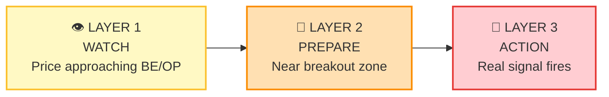
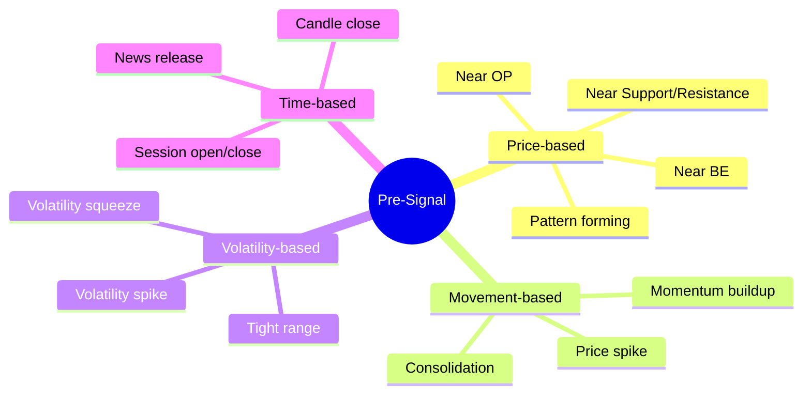
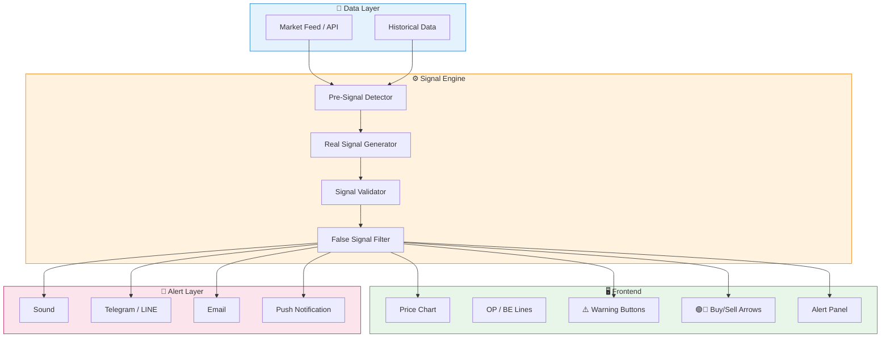
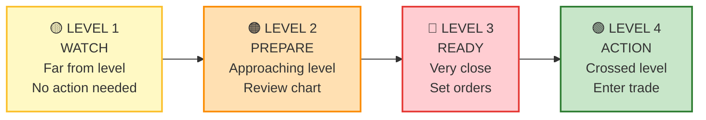
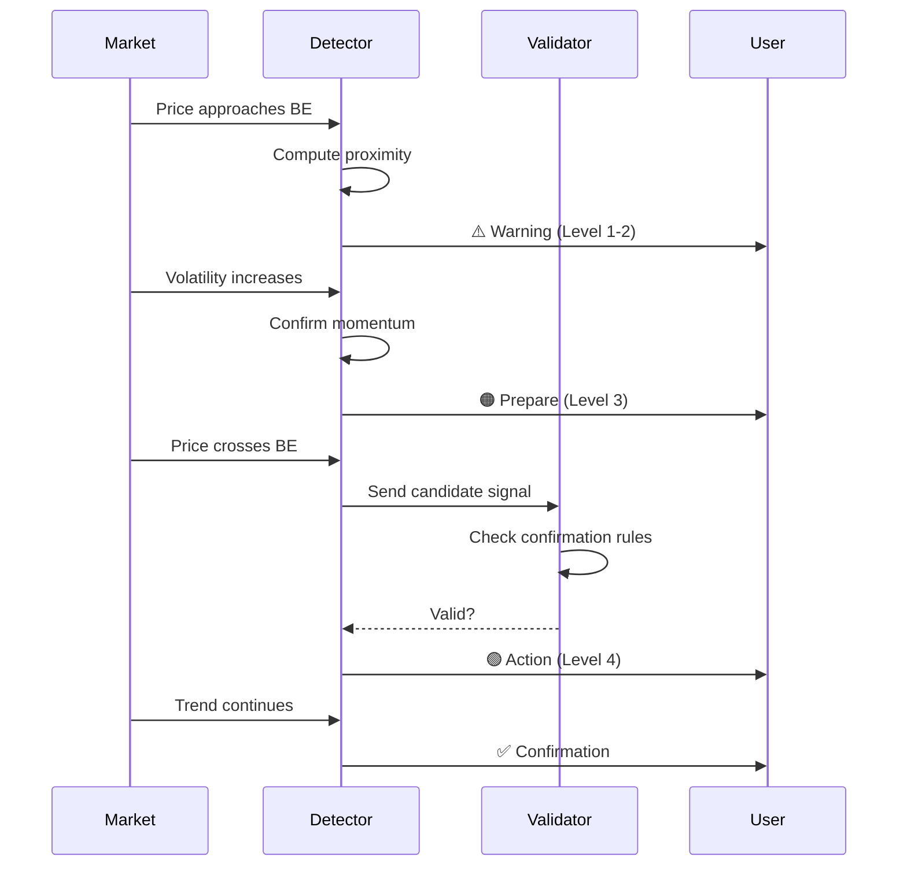
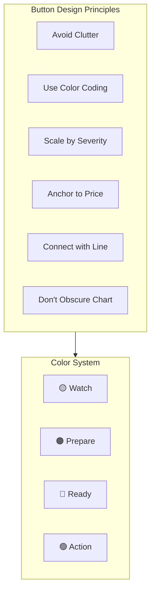
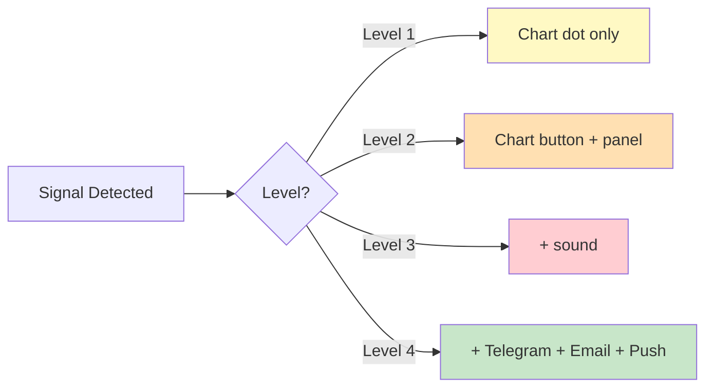
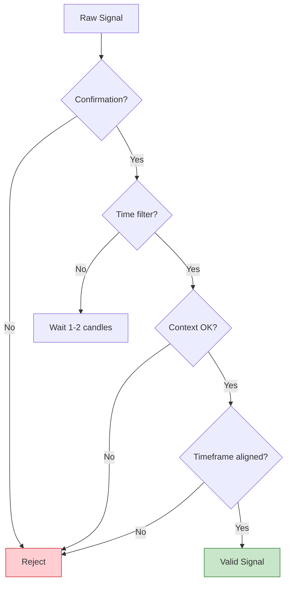
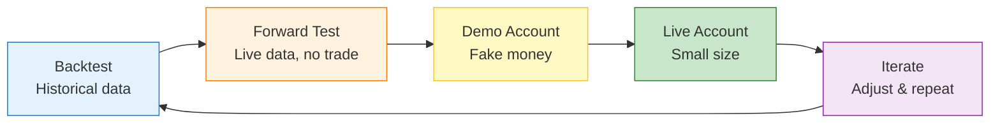
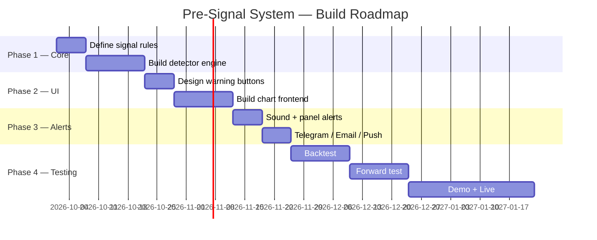

# Pre-Signal System — README

A **Pre-Signal System** for trading charts that warns traders **before** a real signal appears, helping them prepare for strong market movements, breakouts, and volatility spikes around **BE (Break Even)** and **OP (Opening Price)** levels.

---

## Table of Contents

1. [Overview](#overview)
2. [Core Concept](#core-concept)
3. [Signal Layers](#signal-layers)
4. [Pre-Signal Types](#pre-signal-types)
5. [System Architecture](#system-architecture)
6. [Warning Levels](#warning-levels)
7. [Signal Flow](#signal-flow)
8. [UI / Button Design Principles](#ui--button-design-principles)
9. [Alert Pipeline](#alert-pipeline)
10. [False Signal Prevention](#false-signal-prevention)
11. [Design Principles](#design-principles)
12. [Testing Workflow](#testing-workflow)
13. [Roadmap](#roadmap)

---

## Overview

Most traders face three problems:

- 🐢 Entering **too late** — price already moved
- ⚡ Entering **too early** — false signals
- 🌀 Not knowing **when** the market will explode

The **Pre-Signal System** solves this by:

- ⚠️ Warning **before** the real signal
- 🎯 Giving the trader time to **prepare**
- 🧭 Showing the **direction** the market is heading

---

## Core Concept

The system focuses on **BE** and **OP** levels as psychological price zones:

| Level | Meaning | Role |
|-------|---------|------|
| **OP** | Opening Price | Session reference — above = bullish, below = bearish |
| **BE** | Break Even | Traders defend it → strong reactions near it |

**Rule of thumb:** As price approaches BE or OP, the market becomes more volatile — that's when Pre-Signals matter most.

---

## Signal Layers

The system uses **3 progressive layers** — like a staircase:

**Key principle:** A signal should **never pop instantly** — it must progress through stages.

---

## Pre-Signal Types

---

## System Architecture

---

## Warning Levels

The system uses a **traffic-light** model with 4 levels:

| Level | Trigger | User Action |
|-------|---------|-------------|
| 🟡 1 | Price far from BE/OP | Just watch |
| 🟠 2 | Price approaching BE/OP | Review chart, plan |
| 🔴 3 | Price very near BE/OP | Set pending orders |
| 🟢 4 | Price crosses BE/OP | Enter trade |

---

## Signal Flow

---

## UI / Button Design Principles

### Rules

- 🚫 **Don't overcrowd** — too many buttons hide the chart
- 🎨 **Color = severity** — consistent palette across the app
- 📏 **Size matters** — bigger button = higher urgency
- 📌 **Anchor to price** — show where the signal occurred
- 🔗 **Connect with line** — link button to price point
- 👁️ **Never hide candles** — keep chart readable

---

## Alert Pipeline

**Principle:** Higher level = louder alert. This prevents notification fatigue.

---

## False Signal Prevention

### Four Filters

1. **Confirmation** — require 2-3 indicators to agree
2. **Time** — wait 1-2 candles before acting
3. **Context** — check session, news, market regime
4. **Timeframe** — align with higher timeframe trend

---

## Design Principles

| # | Principle | Description |
|---|-----------|-------------|
| 1 | **Progressive signals** | Never pop instantly — stage by stage |
| 2 | **Color-coded severity** | 🟡 → 🟠 → 🔴 → 🟢 |
| 3 | **Confirmation required** | Multiple indicators agree |
| 4 | **Context-aware** | Session, news, timeframe |
| 5 | **BE/OP as psychology** | Not just lines — behavioral zones |
| 6 | **Focus on pre-explosion** | Catch the calm before the storm |
| 7 | **Multi-layer alerts** | Chart → Panel → Sound → External |
| 8 | **User-configurable** | Let traders tune sensitivity |
| 9 | **Test before live** | Backtest → Forward → Demo → Live |
| 10 | **Iterate constantly** | Adjust based on performance |

---

## Testing Workflow

| Stage | Purpose | Risk |
|-------|---------|------|
| Backtest | Validate logic on history | None |
| Forward Test | Observe live behavior | None |
| Demo | Practice execution | None |
| Live | Real trading | Real money |
| Iterate | Improve system | — |

---

## Roadmap

---

## Summary

The **Pre-Signal System** is not about predicting the future — it's about **preparing for it**.

- Warn early
- Confirm carefully
- Act decisively

> "The best trade is the one you were ready for before it happened."

---

## License

MIT — free to use, modify, and distribute.

## Contributing

Pull requests welcome. For major changes, please open an issue first.